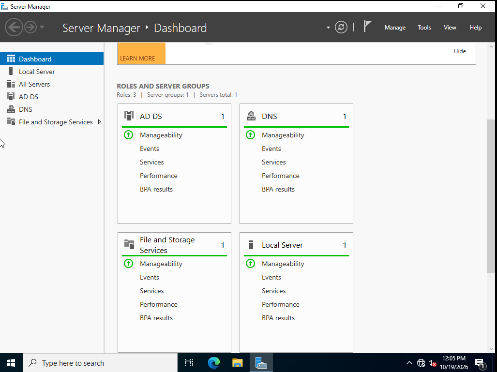
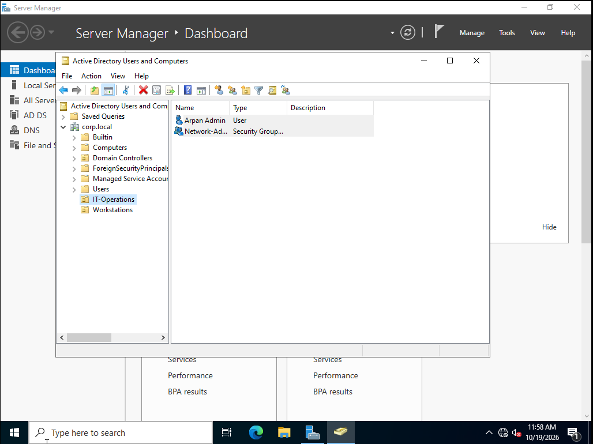
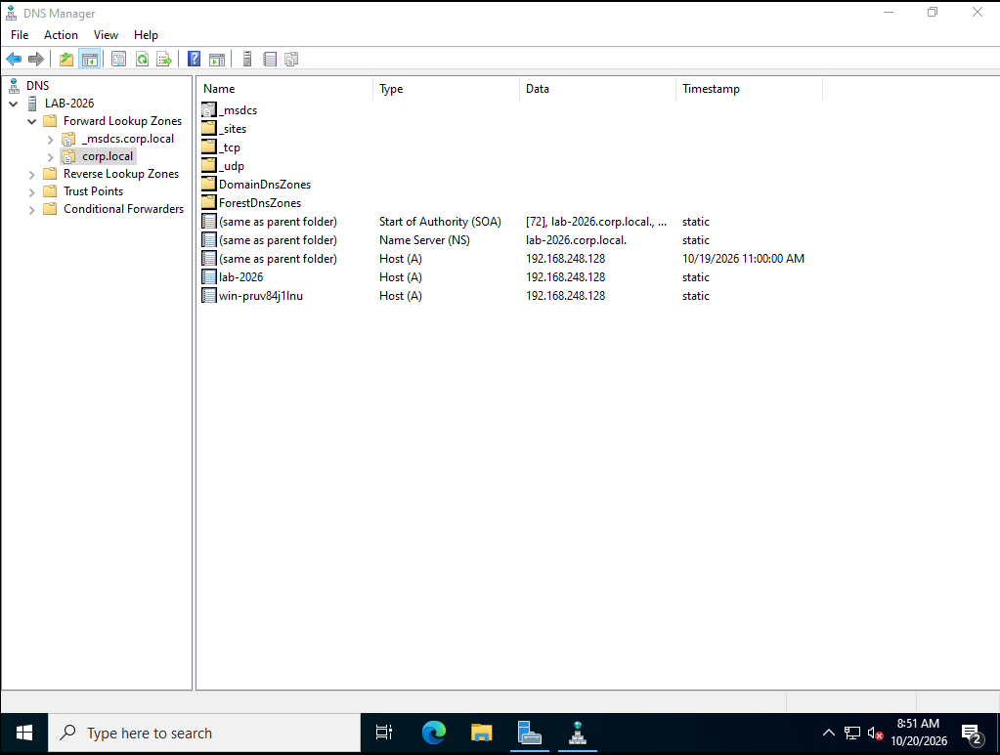
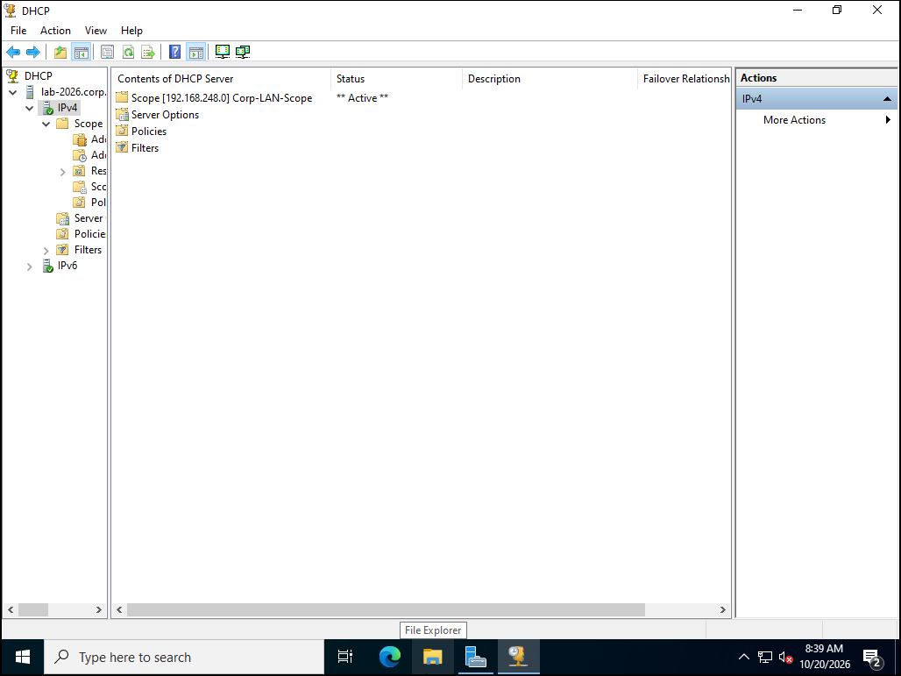
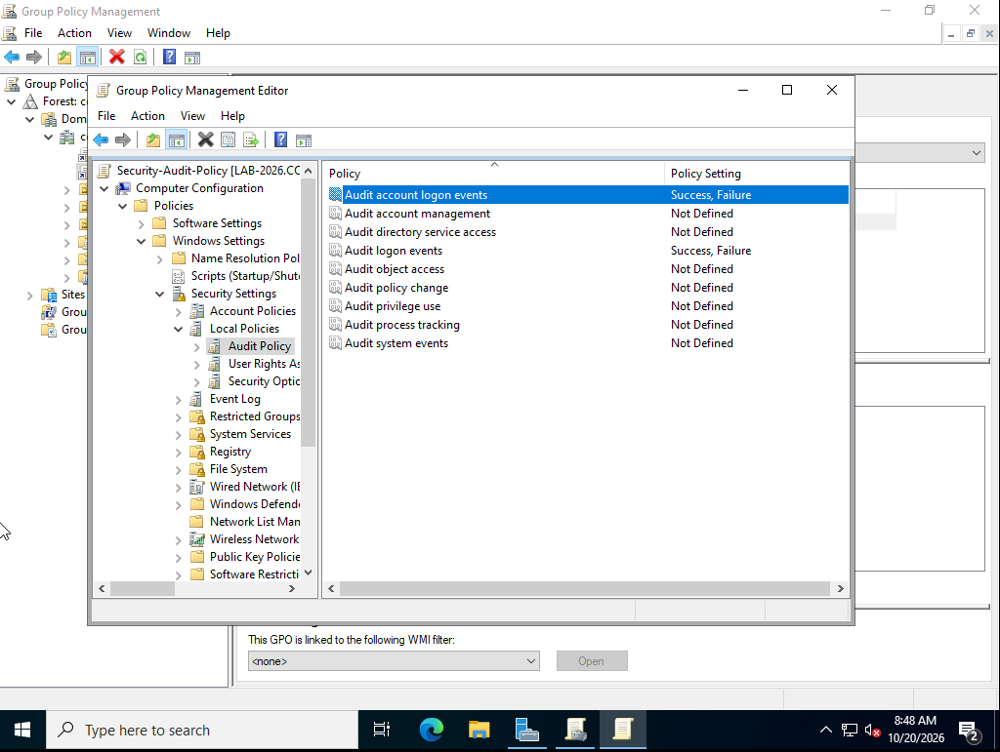
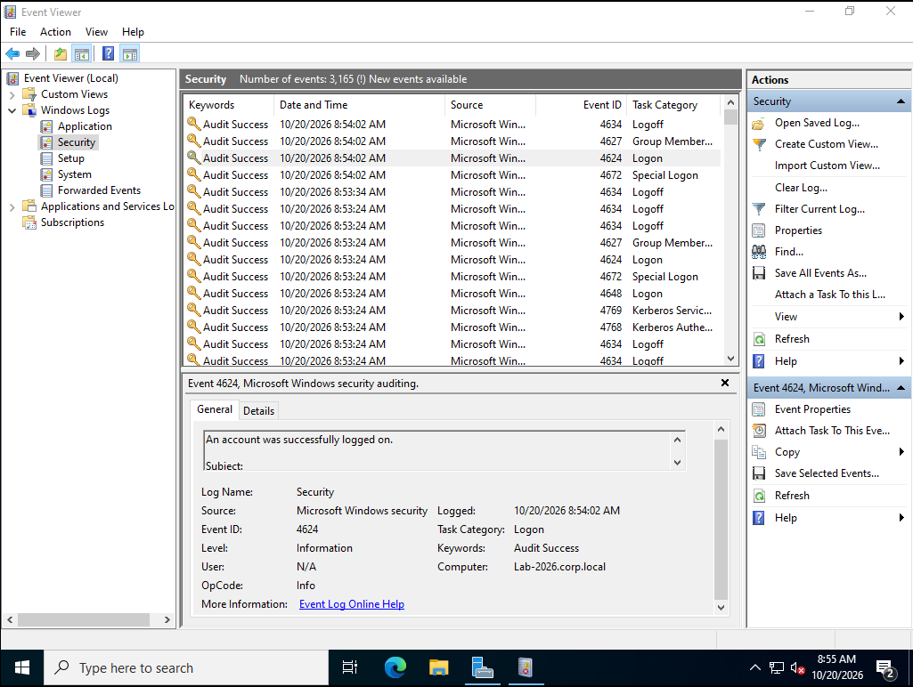
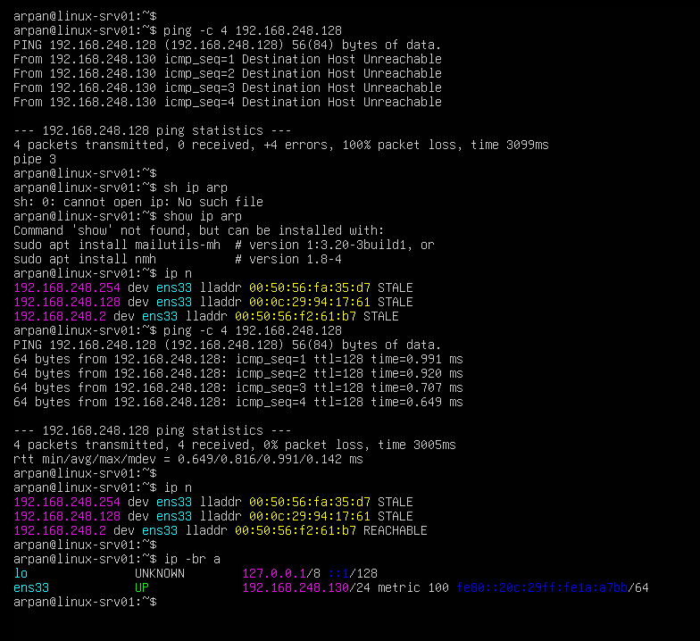
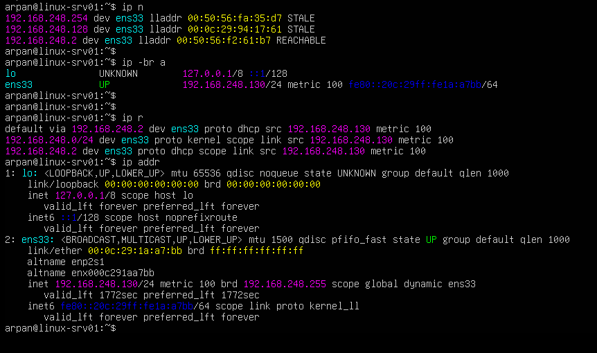
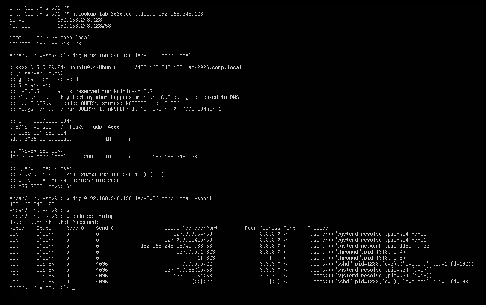
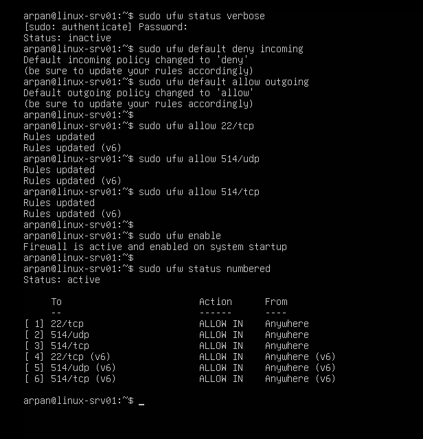

# Windows Server 2022 & Ubuntu Linux Home Lab - Active Directory, DNS, DHCP, GPO & UFW

A two VM single site home lab built on **VMware Workstation Pro (192.168.248.0/24)** featuring a **Windows Server 2022 Domain Controller (lab-2026.corp.local)** and an **Ubuntu Linux Server (linux-srv01)**.

This project documents hands-on setup and verification of Active Directory Domain Services (AD DS), Organizational Units (OUs), AD-integrated DNS, DHCP scope configuration, Group Policy logon auditing, Linux CLI network diagnostics (iproute2, dig, ss), and Linux host firewall rules (ufw).

---

## Lab Environment (192.168.248.0/24 VMware NAT Segment)

| Component | Hostname / Role | IPv4 Address | Configuration Summary |
| --- | --- | --- | --- |
| **Windows Server 2022** | lab-2026.corp.local (Domain Controller) | 192.168.248.128/24 | AD DS (corp.local), DNS Server, DHCP Server (192.168.248.150-200), Group Policy Security Auditing |
| **Ubuntu Server 24.04 LTS** | linux-srv01 (Linux Client & Log Host) | 192.168.248.130/24 | Cross-host ARP/ICMP/DNS verification (ip, dig, nslookup), port inspection (ss -tulnp), "ufw" firewall (22/tcp, 514/udp, 514/tcp) |
| **VMware NAT Gateway** | Default Gateway & DNS Forwarder | 192.168.248.2/24 | Provides outbound NAT routing and external DNS forwarding for the 192.168.248.0/24 lab subnet |

---

## Lab Architecture

```text
┌───────────────────────────────────────────────────────────────────────────┐
│               VMware Workstation Pro — Lab Subnet (192.168.248.0/24)      │
│                        Default Gateway: 192.168.248.2                     │
│                                                                           │
│  ┌────────────────────────────────────┐   ┌────────────────────────────┐  │
│  │ Windows Server 2022 DC             │   │ Ubuntu Linux Server        │  │
│  │ Host: lab-2026.corp.local          │   │ Host: linux-srv01          │  │
│  │ IP:   192.168.248.128/24           │◄─►│ IP:   192.168.248.130/24   │  │
│  ├────────────────────────────────────┤   ├────────────────────────────┤  │
│  │ • AD DS: corp.local                │   │ • L2/L3 Verification:      │  │
│  │   ├── OU: IT-Operations            │   │   ip a, ip r, ip n, ping   │  │
│  │   │   ├── User: Arpan Admin        │   │ • Remote AD DNS Queries:   │  │
│  │   │   └── Group: Network-Admins    │   │   dig @192.168.248.128     │  │
│  │   └── OU: Workstations             │   │   nslookup lab-2026...     │  │
│  │ • DNS: corp.local (SOA, NS, A)     │   │ • Socket Inspection:       │  │
│  │ • DHCP: 192.168.248.150–200        │   │   sudo ss -tulnp           │  │
│  │ • GPO: Security-Audit-Policy       │   │ • Host Firewall (UFW):     │  │
│  │ • Logs: Event IDs 4624, 4672       │   │   Allow 22/tcp, 514/udp/tcp│  │
│  └────────────────────────────────────┘   └────────────────────────────┘  │
└───────────────────────────────────────────────────────────────────────────┘
```

---

## Part 1: Windows Server 2022 Domain Controller (192.168.248.128)

### 1. Server Manager - AD DS & DNS Roles Active
Installed "AD-Domain-Services" and "DNS" roles with management tools and promoted the server to a Domain Controller for the new `corp.local` forest.


### 2. Active Directory Users, Groups & Organizational Units (dsa.msc)
Created Organizational Units (IT-Operations and Workstations), created user account Arpan Admin (aadmin@corp.local), and added it to the Network-Admins security group.


### 3. DNS Manager - Forward Lookup Zone (dnsmgmt.msc)
Verified AD-integrated DNS records (SOA, NS, and Host (A) records resolving lab-2026.corp.local to 192.168.248.128).


### 4. DHCP Server - Active IPv4 Scope (dhcpmgmt.msc)
Authorized lab-2026.corp.local in Active Directory and configured IPv4 scope Corp-LAN-Scope (192.168.248.150 – 192.168.248.200/24, Option 003 Router 192.168.248.2, Option 006 DNS 192.168.248.128).


### 5. Group Policy Management - Logon Auditing (gpmc.msc)
Created and linked Security-Audit-Policy to corp.local, enabling **Success & Failure** auditing for Account Logon Events and Logon Events.


### 6. Windows Event Viewer - Security Log Verification (eventvwr.msc)
Verified audit events in Windows Logs -> Security, including **Event ID 4624** (*An account was successfully logged on*), **Event ID 4672**, and **Kerberos authentication events (4768/4769)**.


---

## Part 2: Client-Side Network & DNS Verification from Ubuntu Linux (192.168.248.130)

To test connectivity and DNS resolution from a second host on the 192.168.248.0/24 subnet, an Ubuntu Server VM (linux-srv01) was deployed on the same virtual switch.

### 7. Layer 2 ARP Resolution (ip n) & ICMP Reachability (ping -c 4)
Verified Layer 2 MAC resolution (00:0c:29:94:17:61) and ICMP reachability between linux-srv01 (192.168.248.130) and lab-2026.corp.local (192.168.248.128).


### 8. Linux Kernel Routing Table (ip r) & Interface Inspection (ip addr)
Verified interface ens33 (LOWER_UP, 192.168.248.130/24) and the kernel routing table (default via 192.168.248.2).


### 9. Cross-Host DNS Query against Windows DC (dig & nslookup) & Port Inspection (ss -tulnp)
Queried the Windows Domain Controller (192.168.248.128) from Linux using nslookup and dig @192.168.248.128 lab-2026.corp.local, confirming an authoritative response (flags: qr aa rd ra, status: NOERROR, IN A 192.168.248.128 in 0 msec), and inspected local listening sockets with "sudo ss -tulnp".


### 10. Linux Host Firewall Hardening (ufw)
Configured ufw on linux-srv01 with a default-deny inbound policy (sudo ufw default deny incoming) and explicit allow rules for OpenSSH (22/tcp) and Syslog (514/udp, 514/tcp).


---

## Commands Used

### Windows Server 2022 (PowerShell)
```powershell
# 1. Verify IP, MAC, and DNS configuration
ipconfig /all

# 2. Install AD DS and DNS Server roles with management tools
Install-WindowsFeature -Name AD-Domain-Services, DNS -IncludeManagementTools

# 3. Point Primary DNS to local AD DNS (127.0.0.1) and Secondary DNS to the
#    VMware NAT Gateway (192.168.248.2) for external internet name resolution
Set-DnsClientServerAddress -InterfaceAlias "Ethernet0" -ServerAddresses ("127.0.0.1","192.168.248.2")

# 4. Promote server to Domain Controller for new forest corp.local
Install-ADDSForest 
    -DomainName "corp.local" 
    -DomainNetbiosName "CORP" 
    -InstallDns:$true 
    -Force:$true

# 5. Refresh Group Policy after linking Security-Audit-Policy
gpupdate /force
```

### Ubuntu Linux Server (linux-srv01 Bash CLI)

# 1. Inspect Layer 2/3 interfaces, routing table, and ARP neighbor cache

1. ip -br a
2. ip addr
3. ip route
4. ip neigh

# 2. Verify ICMP connectivity and DNS resolution against Windows DC (192.168.248.128)

1. ping -c 4 192.168.248.128
2. nslookup lab-2026.corp.local 192.168.248.128
3. dig @192.168.248.128 lab-2026.corp.local

# 3. Inspect listening TCP and UDP sockets

1. sudo ss -tulnp

# 4. Configure UFW host firewall

1. sudo ufw default deny incoming
2. sudo ufw default allow outgoing
3. sudo ufw allow 22/tcp
4. sudo ufw allow 514/udp
5. sudo ufw allow 514/tcp
6. sudo ufw enable
7. sudo ufw status numbered
```
